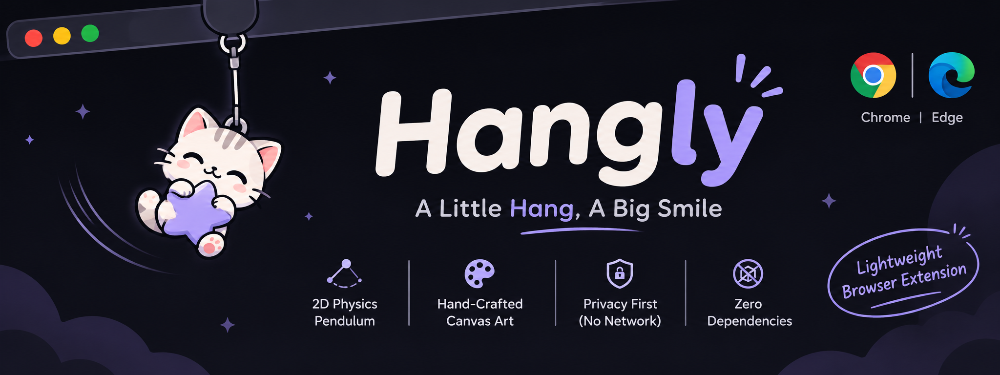

<p align="center">
  
</p>

<h1 align="center">Hangly (Little Hang)</h1>

<p align="center">
  <strong>A little personality for your browser tabs.</strong><br>
  Hang interactive desktop-style charms with real 2D pendulum physics, customizable ropes, and hand-crafted artwork.
</p>

<p align="center">
  <a href="https://developer.chrome.com/docs/extensions/mv3/intro/"></a>
  <a href="#"></a>
  <a href="#"></a>
  <a href="#"></a>
  <a href="LICENSE"></a>
</p>

---

## 📌 Table of Contents

- [Overview](#-overview)
- [✨ Key Features](#-key-features)
- [🎮 Interactive Controls](#-interactive-controls)
- [🚀 Quick Installation](#-quick-installation)
- [🎨 Charm Collection](#-charm-collection)
- [🏗️ Key Architectural Overview](#️-key-architectural-overview)
- [⚙️ Physics & Simulation Engine](#️-physics--simulation-engine)
- [🛠️ Architecture & Codebase Map](#️-architecture--codebase-map)
- [🧪 Testing & Development](#-testing--development)
- [🔒 Privacy & Permissions](#-privacy--permissions)
- [🤝 Contributing](#-contributing)
- [📄 License](#-license)

---

## 🌟 Overview

**Hangly** brings the comforting presence of physical desktop accessories into your web browsing experience. Whether you want a gentle companion while working, a swinging anime icon, a working cross-tab stopwatch, or your own custom image, Hangly attaches smoothly to the top of any webpage.

Built completely with **vanilla JavaScript**, **HTML5 Canvas 2D**, and **native browser APIs**—no bundlers, no frameworks, no third-party libraries, and zero network tracking.

---

## ✨ Key Features

- **Realistic 2D Rope & Pendulum Physics**:
  - Implements gravity, velocity damping, spring recoil, and unilateral rope tension (slack when pushed up, taut when pulled down).
  - Automatically settles and sleeps to ensure zero CPU/GPU overhead when resting.
- **20 Hand-Crafted Charms + Custom Uploads**:
  - Anime & Pop Culture favourites (Spider-Man, Thor Hammer, Captain America Shield, Madara Susanoo, Gojo Hollow Purple, Naruto Rasenshuriken, Attack Titan, Knight Rider KITT).
  - Everyday companions (Daydream Star, Moonbeam, Little Leaf, Boo Friend, Glowing Diamond, CPTS Certificate).
  - Detailed sprites (Toji Knife, Long-Range Rifle, Animated Superbike).
  - **Upload Your Own**: Drop any personal PNG, JPG, or WebP (up to 5MB) resized client-side to 256×256 with transparency preserved.
- **Rope & Hook Customization**:
  - 3 distinct rope aesthetics: **Thread**, **Steel Chain**, and **Neon Glow**.
  - Adjustable charm size (44px – 100px), rope length (80px – 260px), and horizontal anchor position (8% – 92%).
  - Fully draggable metallic ceiling hook with realistic wrap cords.
- **Synchronized Global Stopwatch**:
  - Built-in working stopwatch with Start/Pause and Reset controls on both the charm and popup.
  - Timestamp-based calculation: never loses accuracy across tab closures, refreshes, or browser restarts.
- **Performance & Battery Friendly**:
  - Pauses all animations and physics loops when tabs are hidden (`document.hidden`).
  - Throttles ambient particle effects when settled.
- **Accessibility & Motion Comfort**:
  - Full WAI-ARIA slider semantics for the repositioning hook.
  - Complete keyboard navigation support.
  - Automatic adaptation to system `prefers-reduced-motion` plus an in-app "Less motion" setting.

---

## 🎮 Interactive Controls

Hangly is designed to feel physical and responsive across mouse, touch, and keyboard:

| Target | Input / Gesture | Action |
|---|---|---|
| **Ceiling Hook** | **Click & Drag (Left / Right)** | Moves the anchor point along the top of your window. |
| **Ceiling Hook** | `←` / `→` (Arrow Keys) | Nudges the hook horizontally (`Shift` for $5\times$ speed). |
| **Ceiling Hook** | `Home` / `End` | Jumps the hook to the extreme left (8%) or right (92%). |
| **Ceiling Hook** | `Escape` | Cancels an ongoing drag and restores previous position. |
| **Charm** | **Click & Drag** | Pull to stretch, push up for slack, or toss sideways to swing. |
| **Charm** | `↑` `↓` `←` `→` (Arrow Keys) | Delivers a directional impulse / nudge. |
| **Charm** | `Escape` | Instantly settles the charm to resting equilibrium. |
| **Stopwatch** | **Start / Pause Button** | Starts or pauses the shared timer. |
| **Stopwatch** | **Reset Button** | Resets the elapsed time back to zero. |

---

## 🚀 Quick Installation

Hangly runs unpacked on any Chromium-based browser (**Google Chrome**, **Microsoft Edge**, **Brave**, **Opera**, **Vivaldi**):

1. **Clone or Download** this repository:
   ```bash
   git clone https://github.com/Fahath0x/hangly.git
   ```
   *(Or download and extract the ZIP archive).*
2. Open your browser's extensions management page:
   - **Chrome**: `chrome://extensions`
   - **Edge**: `edge://extensions`
3. Toggle on **Developer mode** (usually found in the top-right or sidebar).
4. Click **Load unpacked** and select the root directory (containing `manifest.json`).
5. Pin **Hangly** to your browser toolbar from the Extensions menu.
6. Open any regular website (e.g. `https://github.com` or `https://en.wikipedia.org`) and refresh once to start hanging your charm!

> [!NOTE]
> Extensions do not inject into browser-internal pages (`chrome://*`, `edge://*`) or Web Store pages for security reasons.

---

## 🎨 Charm Collection

<details>
<summary><strong>Click to expand the complete list of 20 built-in charms</strong></summary>

| Charm Name | Visual Highlights | Dynamic Effects |
|---|---|---|
| **Daydream** | Warm golden star with expressive face | Gentle swaying shadow |
| **Moonbeam** | Lavender crescent moon with starry night tones | Damped pendular tilt |
| **Little Leaf** | Potted plant supported by dual braided cords | Cord matches Thread, Chain, or Glow |
| **Boo Friend** | Cozy floating ghost companion | Damped wave motion |
| **Sweet Thing** | Pastel pink heart | Expressive blushing accents |
| **Spider-Man Mask** | Iconic webbed red mask | Clean comic-style vector strokes |
| **Spider-Man (Full)** | Upside-down acrobatic web-hanger | Poses upside down along the cord |
| **Thor Hammer** | Mjölnir with metallic head & leather strap | Pulsing blue lightning arcs |
| **Captain America** | Vibrant vibranium shield with concentric stars | Metallic specular gradients |
| **Madara** | Uchiha legend backed by ethereal Susanoo | Soft chakra glow and aura |
| **Naruto** | Sage outfit holding Rasenshuriken | Spinning wind shuriken energy |
| **Eren & Attack Titan** | Dual profile of Eren Yeager & Attack Titan | Steaming titan eye details |
| **Gojo Satoru** | Blindfolded Gojo summoning Hollow Purple | Pulsing violet sphere & orbital particles |
| **Knight Rider KITT** | Sleek black sports car nose | Left-to-right red scanner sweep |
| **Working Stopwatch** | Vintage pocket-watch aesthetic | Live digital readout & overlay buttons |
| **CPTS Certificate** | Framed cybersecurity certificate & seal | Detailed frame & security emblem |
| **Glowing Diamond** | Multi-faceted icy blue gemstone | Moving reflections and sparkle flares |
| **Toji Knife** | Inverted Spear of Heaven hook-blade | High-resolution transparent sprite |
| **Long-Range Rifle** | Olive-and-graphite tactical rifle with scope | Top hanging eyelet & folded bipod |
| **Superbike** | Aerodynamic red sport racing motorcycle | Spinning wheel spokes, engine vibration & headlamp flare |

</details>

---

## 🏗️ Key Architectural Overview

Hangly is structured as a decoupled Manifest V3 system where user interactions, state persistence, physics simulation, and visual rendering operate in distinct, sandboxed execution contexts:

```
                      ┌──────────────────────────────────────┐
                      │      popup.html / popup.js           │
                      │  - Settings & Live Preview Stage     │
                      │  - Image Upload & 256px Downscaling  │
                      │  - Direct Stopwatch Controls         │
                      └──────────────────┬───────────────────┘
                                         │ chrome.storage.local
                                         │ chrome.runtime.sendMessage
                                         ▼
┌─────────────────────────┐  Sync  ┌──────────────────────────────────────┐
│  content.js / stage.js  │◄──────►│       background.js (SW)             │
│  - <little-hang-companion│        │  - Default storage bootstrapping     │
│  - Closed Shadow DOM    │        │  - Serialized stopwatch state queue  │
│  - Physics & Rendering  │        │  - CSP-isolated asset fetch & decode │
└─────────────────────────┘        └──────────────────────────────────────┘
```

### Component Roles & Communication

1. **Popup Interface (`popup.js`)**:
   - Manages user settings (charm selection, rope style, dimensions, motion preference).
   - Hosts an interactive, self-contained mini-stage previewing physics and animations in real time.
   - Processes image uploads client-side via `createImageBitmap()` and Canvas 2D downscaling ($256 \times 256$ max) before saving base64 pixels to local storage.
2. **Background Service Worker (`background.js`)**:
   - **Default Bootstrapping**: Initializes storage keys on install (`settings`, `stopwatch`).
   - **Concurrency Serialization**: Sequences stopwatch mutations through a chained promise queue (`stopwatchQueue`), preventing race conditions when multiple tabs or the popup click Start/Reset simultaneously.
   - **CSP-Isolated Asset Pipeline**: Reads packaged binary PNG textures (`toji-knife`, `long-range-rifle`, `superbike`) via `fetch()` and passes base64 bytes to content scripts. This ensures artwork loads even on websites with strict `img-src 'none'` Content Security Policies.
3. **Content Script & Stage (`content.js`, `stage.js`)**:
   - Injected into ordinary `http://*` and `https://*` tabs at `document_idle`.
   - Mounts a single `<little-hang-companion>` custom element onto `document.documentElement` with `attachShadow({ mode: "closed" })` and `pointer-events: none`, guaranteeing zero stylesheet or script collisions with the underlying page.
   - Synchronizes instantly with other tabs via `chrome.storage.onChanged`.

---

## ⚙️ Physics & Simulation Engine

At the heart of Hangly is `RopeBody` (`physics.js`), a custom 2D spring-mass pendulum simulation engineered specifically to replicate the tactile feel of an elastic hanging strap or lanyard.

### 1. Mathematical Model

The charm is modeled as a point mass subjected to gravity, spring tension, internal rope damping, and air drag:

$$\vec{F}_{\text{net}} = \vec{F}_{\text{gravity}} + \vec{F}_{\text{tension}} + \vec{F}_{\text{drag}}$$

$$\vec{a} = \frac{\vec{F}_{\text{net}}}{m} = \begin{bmatrix} 0 \\ g \end{bmatrix} - \frac{T \cdot \hat{r} + \gamma \vec{v}}{m}$$

Where:
* $g = 1400\text{ px/s}^2$ (downward gravitational acceleration)
* $\gamma = 0.7$ (air resistance coefficient)
* $k = 90$ (rope stiffness / spring constant)
* $c = 6.5$ (rope material damping coefficient)
* $\hat{r} = \left[ \frac{x}{d}, \frac{y}{d} \right]$ (unit vector along the rope axis, where $d = \sqrt{x^2 + y^2}$)

### 2. Unilateral Rope Constraint (Slack vs. Taut)

Unlike a rigid rod pendulum or a standard bidirectional harmonic spring, **a rope cannot exert compressive force**. When the charm is lifted or pushed toward the hook ($d < L_{\text{unloaded}}$), the rope becomes completely slack:

$$T = \begin{cases} k \cdot \Delta L + c \cdot (\vec{v} \cdot \hat{r}) & \text{if } \Delta L > 0 \\ 0 & \text{if } \Delta L \le 0 \end{cases}$$

When lifted above resting height, the charm falls under pure freefall acceleration ($g$) until the line snaps taut, creating natural pendular arcs, bounces, and slack loops.

### 3. Exact Equilibrium Calibration

In standard spring simulations, hanging under gravity causes steady-state elongation:

$$\Delta L_{\text{eq}} = \frac{g}{k} = \frac{1400}{90} \approx 15.55\text{ px}$$

To ensure the user-selected rope length in the settings popup matches the exact visual settled hanging distance, the unloaded resting length is dynamically calibrated:

$$L_{\text{unloaded}} = \max\left(1, L_{\text{target}} - \frac{g}{k}\right)$$

### 4. Numerical Sub-Stepping

To prevent instability, tunneling, or numerical explosions when the charm is thrown vigorously across the screen:
* Frame deltas are clamped to $\Delta t \le 0.04\text{ s}$ ($25\text{ FPS}$ minimum timestep).
* Time steps are subdivided up to 240 sub-steps per second:
  $$h = \frac{\Delta t}{\lceil \Delta t \cdot 240 \rceil}$$
* Position and velocity are updated via symplectic Euler integration across each sub-step.

### 5. Collision Boundaries & Elastic Restitution

The charm is constrained within viewport margins. When hitting boundary limits:
$$v_{\text{axis}} \leftarrow -0.22 \cdot v_{\text{axis}}$$
This soft-bounce restitution ($e = 0.22$) prevents the charm from clipping off-screen while dampening impact energy quickly.

### 6. Zero-Overhead Sleep State

To preserve CPU cycles and mobile/laptop battery life, `RopeBody` actively monitors its kinematic energy:
```javascript
get settled() {
  return Math.abs(this.x) < 0.08 && Math.abs(this.y - this.length) < 0.08
    && Math.abs(this.vx) < 0.8 && Math.abs(this.vy) < 0.8;
}
```
When settled, `requestAnimationFrame` automatically stops, putting the physics engine to sleep until the user nudges or drags the charm again.

---

## 🛠️ Architecture & Codebase Map

Hangly maintains complete separation of concerns without external runtime dependencies:

```
Hangly/
├── manifest.json         # Manifest V3 specification & content script declarations
├── shared.js             # Shared data definitions, clamp math, and input sanitizers
├── physics.js            # RopeBody: 2D mass-spring pendulum mechanics & constraints
├── stopwatch.js          # Timestamp-based timekeeping logic & state reducers
├── builtin-art.js        # CSP-isolated bitmap decoding via Background Service Worker
├── art.js                # Procedural HTML5 Canvas rendering for 20 charms & animations
├── stage.js              # Closed Shadow DOM host, canvas transform, gestures & a11y
├── content.js            # Content script: isolated DOM injection & cross-tab sync
├── popup.html/.css/.js   # Extension settings interface & real-time live preview stage
├── icons/                # Extension toolbar & store icons (16px, 32px, 48px, 128px)
├── assets/               # Packaged images, prompts, and project banner
│   ├── hangly-banner.png # Official project showcase banner
│   ├── kawaii-cat-icon.png# High-resolution master icon artwork
│   ├── superbike.png
│   ├── toji-knife.png
│   └── long-range-rifle.png
└── tests/
    ├── core.test.cjs     # 11 unit tests using native Node.js test runner
    └── browser.mjs       # Zero-dependency CDP headless browser integration test
```

### Component Interaction Flow

1. **Host Injection**: `content.js` creates an isolated `<little-hang-companion>` host with a closed Shadow DOM overlay set to `z-index: 2147483646`.
2. **State Storage**: User preferences (charm choice, dimensions, rope style, anchor) are stored in `chrome.storage.local`.
3. **Cross-Tab Synchronization**: Any adjustment in the popup or on-page anchor drag immediately triggers `chrome.storage.onChanged`, seamlessly updating every open tab in real time.
4. **CSP Resilience**: For packaged PNG artwork, requests are delegated through `background.js` to prevent target website `img-src` Content Security Policies from blocking textures.

---

## 🧪 Testing & Development

Hangly emphasizes rock-solid reliability through comprehensive tests using **zero npm packages**.

### 1. Run Unit Tests (Node.js)
Validates input sanitization, slack-rope mechanics, vertical recoil, horizontal swing, bounds checking, and stopwatch arithmetic:

```bash
node --test tests/core.test.cjs
```

### 2. Run End-to-End Browser Integration Tests
Spawns a clean, isolated headless Chrome or Edge instance, navigates via native Chrome DevTools Protocol (CDP), executes drag gestures, verifies click-through transparency on underlying web content, and generates visual screenshots in `artifacts/`:

```bash
node tests/browser.mjs
```

---

## 🔒 Privacy & Permissions

- **100% Client-Side**: All physics, rendering, and customizations happen strictly inside your browser.
- **No Remote Servers or Telemetry**: No tracking, no user analytics, no external API calls, and no accounts required.
- **Minimal Permissions**: Requests only `"storage"` to persist your charm preferences and stopwatch state. No browsing history access, no `<all_urls>` permission, and no page content inspection.
- **Local Uploads**: Custom uploaded pictures are resized in memory and stored locally in extension storage; they are never sent over the network.

---

## 🤝 Contributing

Contributions are warmly welcomed! To contribute:

1. **Fork** the repository and create your feature branch:
   ```bash
   git checkout -b feature/new-charm
   ```
2. **Implement your changes**:
   - Follow the existing plain vanilla JavaScript conventions (no bundlers or transpilers).
   - If adding a charm, define its vector artwork in `art.js` and register its metadata in `shared.js`.
3. **Verify tests pass**:
   ```bash
   node --test tests/core.test.cjs
   ```
4. **Commit and open a Pull Request** with a concise description of your additions.

---

## 📄 License

This project is licensed under the [MIT License](LICENSE) — feel free to use, modify, and distribute it freely.
